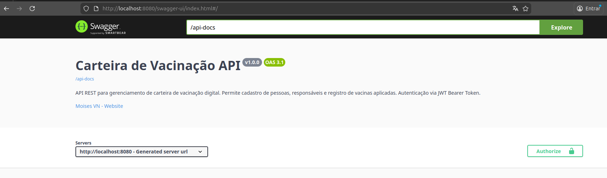

# 💉 API Carteira de Vacinação Digital


[](https://hub.docker.com/r/moisesvn/carteira-vacinacao-api)
[](https://hub.docker.com/r/moisesvn/carteira-vacinacao-api)

<!-- Depois de criar o CI:  -->

API REST em **Java 21 + Spring Boot** para pais e responsáveis acompanharem o calendário vacinal da família: histórico de doses, doses pendentes e atrasadas segundo o **PNI** e alergias de cada pessoa.

> A aplicação **complementa** a carteira de vacinação física oficial. Ela não substitui o documento.

<!-- Depois do deploy: 🔗 **Demo (Swagger):** https://... -->

---

## ✨ Destaques técnicos

- **Arquitetura em camadas** (Controller → Service → Repository), com DTOs e mappers. Nenhuma entidade JPA sai na resposta da API.
- **Spring Security + JWT** (stateless) e senhas com **BCrypt**. O segredo do JWT é obrigatório via variável de ambiente, sem valor padrão no código
- **Controle de acesso por posse dos dados (proteção contra IDOR)**: cada usuário só vê e altera as pessoas vinculadas a ele (e as vacinas e alergias delas) e a própria conta. A regra fica centralizada em um único serviço (`AcessoService`)
- **Flyway** com 6 migrações versionadas, incluindo a **carga do calendário do PNI** e de alergias comuns
- **Tratamento global de erros** (`@ControllerAdvice`) e validação com Bean Validation
- **Imagem no [Docker Hub](https://hub.docker.com/r/moisesvn/carteira-vacinacao-api)**: build multi-stage e **multi-arquitetura (amd64 e arm64)**, tags semânticas (`1.0.0`, `1.0`, `1`, `latest`), execução sem root, `no-new-privileges` e `cap_drop: ALL`
- **Testes de carga com k6** (smoke, load, stress, soak) e resultados documentados

---

## 🚀 Como executar

### Opção A: imagem pronta do Docker Hub (só precisa de Docker)

Imagem: [`moisesvn/carteira-vacinacao-api`](https://hub.docker.com/r/moisesvn/carteira-vacinacao-api) (amd64 e arm64; roda também em Mac com Apple Silicon).

```bash
curl -O https://raw.githubusercontent.com/MoisesVNdev/api-carteira-vacinacao/main/docker-compose.dockerhub.yml
curl -o .env https://raw.githubusercontent.com/MoisesVNdev/api-carteira-vacinacao/main/.env.example
# edite o .env: POSTGRES_PASSWORD e JWT_SECRET (gere com: openssl rand -base64 64)
docker compose -f docker-compose.dockerhub.yml up -d
```

> O `JWT_SECRET` precisa estar em **base64** e ter pelo menos 32 bytes. Sem ele, o compose se recusa a subir.

### Opção B: build local

```bash
git clone https://github.com/MoisesVNdev/api-carteira-vacinacao.git
cd api-carteira-vacinacao
cp .env.example .env   # preencha as credenciais
docker compose up -d --build
```

### Opção C: sem Docker
Requer Java 21, Maven 3.9+ e PostgreSQL 16. Configure `SPRING_DATASOURCE_URL`, `SPRING_DATASOURCE_USERNAME`, `SPRING_DATASOURCE_PASSWORD` e `JWT_SECRET`, depois rode `./mvnw spring-boot:run`.

### Acessos
| Recurso | URL |
|---|---|
| Swagger UI | http://localhost:8080/swagger-ui.html |
| Health check | http://localhost:8080/actuator/health |



---

## 🏗️ Arquitetura

```
Requisição → [JwtAuthenticationFilter] → [Controller] → [Service] → [Repository] → PostgreSQL
                                             ↑ DTO           ↑ regras        ↑ Spring Data JPA
                                                             de negócio
```

```
src/main/java/com/moisesvn/carteira_vacinacao_api/
├── config/       configurações (CORS, beans)
├── controller/   camada HTTP
├── dto/          contratos de entrada e saída
├── exception/    exceções e handler global
├── mapper/       Entidade ↔ DTO
├── model/        entidades JPA
├── repository/   Spring Data JPA
├── security/     JWT, filtros, UserDetailsService
└── service/      regras de negócio
```

### Modelo de dados
`usuario` · `pessoa` · `responsavel` (usuário ↔ pessoa) · `vacina` · `esquema_vacinal` · `registro_vacina` · `alergia` · `pessoa_alergia`
Diagrama EER em [`EER Diagram/V2.0/`](EER%20Diagram/V2.0/).

---

## 🔌 Endpoints principais

| Recurso | Endpoints | Acesso |
|---|---|---|
| Autenticação | `POST /api/v1/auth/register` · `POST /api/v1/auth/login` | Público |
| Usuários | `POST` `GET /api/v1/usuarios` · `GET` `PATCH` `DELETE /api/v1/usuarios/{id}` | Cadastro público; o resto só na própria conta |
| Pessoas | `POST` `GET /api/v1/pessoas` · `GET` `PUT` `DELETE /api/v1/pessoas/{id}` · `GET /api/v1/pessoas/buscar?cpf=&cns=` | Só pessoas vinculadas ao usuário (a busca exige CPF **e** CNS) |
| Responsáveis | `POST /api/v1/responsaveis` (exige o CNS da pessoa) · `GET /api/v1/responsaveis/usuario/{usuarioId}` · `GET` `PATCH` `DELETE /api/v1/responsaveis/{id}` | Só os próprios vínculos |
| Vacinas | `GET /api/v1/vacinas` · `GET /api/v1/vacinas/{id}` · `GET /api/v1/vacinas/{id}/esquema` | Autenticado (somente leitura) |
| Alergias | `GET /api/v1/alergias` · `GET /api/v1/alergias/{id}` · `GET /api/v1/alergias/lote` | Autenticado (somente leitura) |
| Alergias da pessoa | `GET` `POST /api/v1/pessoas/{pessoaId}/alergias` · `POST .../lote` · `PATCH` `DELETE .../{alergiaId}/observacao` · `DELETE .../{alergiaId}` | Só pessoas vinculadas ao usuário |
| Calendário e registros | `GET /api/v1/registros-vacina/pessoas/{pessoaId}/calendario` · `GET .../historico` · `POST /api/v1/registros-vacina/registros` · `DELETE /api/v1/registros-vacina/registros/{id}` | Só pessoas vinculadas ao usuário |

Tentativas de acessar dados de outro usuário recebem **403 Forbidden**.

A documentação completa, com exemplos de request e response, está no Swagger UI. Também há uma coleção Postman e um arquivo `.http` em [`Client-REST-testes/`](Client-REST-testes/).

<details>
<summary>Exemplo com cURL</summary>

```bash
curl -X POST http://localhost:8080/api/v1/auth/register -H "Content-Type: application/json" \
  -d '{"nomeCompleto":"Maria da Silva","email":"maria@example.com","senha":"Senha@123"}'

TOKEN=$(curl -s -X POST http://localhost:8080/api/v1/auth/login -H "Content-Type: application/json" \
  -d '{"email":"maria@example.com","senha":"Senha@123"}' | jq -r '.token')

curl http://localhost:8080/api/v1/vacinas -H "Authorization: Bearer $TOKEN"
```
</details>

---

## 🧪 Testes

<!-- Atualize esta tabela quando os testes forem criados. É a seção que mais pesa para vagas Java. -->
| Tipo | Ferramentas | Status |
|---|---|---|
| Carga do contexto Spring | Spring Boot Test + H2 | ✅ |
| Unitários (services, começando pelas regras de acesso do `AcessoService`) | JUnit 5, Mockito | 🚧 em desenvolvimento |
| Integração (repositories e controllers) | Spring Boot Test, Testcontainers (PostgreSQL) | 🚧 em desenvolvimento |
| Carga e performance | k6 | ✅ ver abaixo |

```bash
./mvnw test     # testes automatizados
./mvnw verify   # testes + relatório de cobertura
```

---

## 📊 Performance (k6)

**Ambiente:** execução local em Docker. Ryzen 5 3600X, 16 GB de RAM, Ubuntu 24.04. App limitado a 1,5 GB de RAM e 4 CPUs; PostgreSQL limitado a 1 GB e 2 CPUs; heap da JVM de 256 a 512 MB (G1GC); HikariCP com no máximo 30 conexões.

| Cenário | Carga | Requisições | P95 | Média | Erro HTTP | Checks |
|---|---|---|---|---|---|---|
| Smoke | 2 VUs / 30 s | 46 | 58,97 ms | 12,14 ms | 0% | 100% (89/89) |
| Load | rampa até 100 VUs / 5 min | 8.668 (26,3 req/s) | **4,06 ms** | 2,79 ms | **0,12%** | 99,84% |


Os cenários de **stress** (até 300 VUs, 13 min) e **soak** (20 VUs, 15 min) estão prontos em [`k6/`](k6/). Os resultados serão publicados aqui depois de uma nova execução com relatório salvo.

**Leitura honesta dos resultados:**
- A latência baixa reflete uma **carga moderada** (cerca de 26 req/s, com pausas de 0,5 a 2 s entre requisições, simulando um usuário real) em ambiente local. O número não deve ser lido como capacidade de produção.
- As 22 falhas de *check* no load test (0,15%) vêm do endpoint de registro vacinal. Ele **rejeitou corretamente** dados duplicados gerados pelo script (mesma data e lote). É regra de negócio funcionando, não falha de performance.
- Próximo passo: medir throughput máximo sem *sleep* e acompanhar o heap da JVM durante o soak test, para avaliar vazamento de memória com dados de memória e não só de latência.

Scripts e instruções em [`k6/`](k6/). <!-- mova o passo a passo detalhado do k6 para k6/README.md -->

---

## 🧠 Decisões técnicas

| Decisão | Motivo |
|---|---|
| Flyway para o schema e os dados do PNI | Schema versionado e reproduzível. O catálogo de vacinas é dado de referência, não cadastro do usuário. O Hibernate não altera o schema (`ddl-auto=none`). |
| DTO + mapper em todas as rotas | Não expor entidades JPA, evitar *over-posting* e desacoplar o contrato da API do modelo de dados |
| JWT stateless | Permite escalar horizontalmente sem sessão compartilhada |
| HikariCP com 30 conexões e PostgreSQL com `max_connections=200` | Folga para mais de uma instância da API sem esgotar o banco |
| Runtime só com JRE (`eclipse-temurin:21-jre-alpine`), usuário sem root e `cap_drop: ALL` | Princípio do menor privilégio: sem compilador nem ferramentas do JDK na imagem final |

---

## 🔒 Segurança e privacidade (LGPD)

Dados de vacinação e alergia são **dados pessoais sensíveis** (LGPD, art. 5º, II).

- ✅ Senhas com BCrypt; segredo do JWT e senha do banco só em variáveis de ambiente
- ✅ Bean Validation em todas as entradas; DTOs em todas as saídas
- ✅ Health check público mostra só UP/DOWN; detalhes apenas para usuário autenticado
- ✅ CPF, CNS e valores dos parâmetros SQL não são gravados em log
- ✅ Cada usuário só acessa as pessoas vinculadas a ele, com as vacinas e alergias delas, e a própria conta (proteção contra IDOR)
- ✅ Para se vincular a uma pessoa já cadastrada, é preciso informar o CNS dela; só o ID não basta
- 🚧 Busca por CPF/CNS via `POST` com corpo (hoje é feita por query string)

### Limitações conhecidas e próximos passos
- [ ] Testes unitários e de integração (JUnit 5, Mockito, Testcontainers) + CI no GitHub Actions
- [ ] Refresh token e rate limiting (Bucket4j)
- [ ] Paginação nas listagens e respostas de erro no padrão RFC 7807 (`ProblemDetail`)
- [ ] Notificação de doses atrasadas (e-mail), via fila de mensagens
- [ ] Upload da foto da carteira física
- [ ] Deploy público com Swagger acessível
- [ ] Atualizar dependências fixadas no `pom.xml` (SpringDoc 3.x e Flyway gerenciado pelo Spring Boot 4; JJWT 0.12.x)

---

## 👨‍💻 Autor

**Moisés Vila Nova de Oliveira**, desenvolvedor backend Java
[GitHub](https://github.com/MoisesVNdev) · [LinkedIn](https://www.linkedin.com/in/moisesvnoliveira/) · [moisesvn.dev@gmail.com](mailto:moisesvn.dev@gmail.com)

Licença [MIT](LICENSE).
